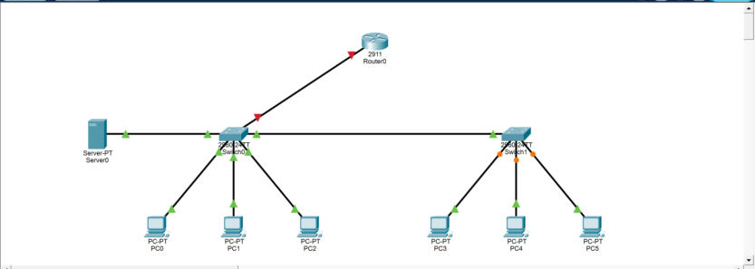

# Network Security Lab

> 🚧 **Work in progress.** This lab is being built in phases. Phase 1 of 8 is complete, see [Progress](#progress) for status.

A small enterprise network built in Cisco Packet Tracer, with a focus on segmentation and device hardening. The lab is built in phases, and each phase is documented here as it is completed.

## Goal

Design a network for a small office where staff, administrators and guests share the same physical infrastructure, but are kept apart logically. Guests should reach the internet only, staff should reach shared services, and only admins should manage network devices.

## Topology

| Device | Model | Role |
|---|---|---|
| Router0 | Cisco 2911 | Gateway, inter-VLAN routing, ACLs |
| Switch0 | Cisco 2960 | Access switch, uplink to router |
| Switch1 | Cisco 2960 | Access switch |
| Server0 | Server-PT | Internal services (DHCP, web) |
| PC0 to PC5 | PC-PT | End users |

### Cabling

| From | Port | To | Port |
|---|---|---|---|
| Router0 | G0/0 | Switch0 | G0/1 |
| Switch0 | G0/2 | Switch1 | G0/1 |
| PC0, PC1, PC2 | Fa0 | Switch0 | Fa0/1, Fa0/2, Fa0/3 |
| Server0 | Fa0 | Switch0 | Fa0/4 |
| PC3, PC4, PC5 | Fa0 | Switch1 | Fa0/1, Fa0/2, Fa0/3 |

### Planned addressing

| VLAN | Name | Subnet | Gateway |
|---|---|---|---|
| 10 | Admin | 192.168.10.0/24 | 192.168.10.1 |
| 20 | Ansatte (Staff) | 192.168.20.0/24 | 192.168.20.1 |
| 30 | Gjest (Guest) | 192.168.30.0/24 | 192.168.30.1 |
| 99 | Management | 192.168.99.0/24 | 192.168.99.1 |

## Progress

- [x] **Phase 1:** Topology and cabling
- [ ] **Phase 2:** VLANs and trunking
- [ ] **Phase 3:** Router on a stick (inter-VLAN routing)
- [ ] **Phase 4:** DHCP per VLAN
- [ ] **Phase 5:** Device hardening (SSH, passwords, banners)
- [ ] **Phase 6:** Access control lists
- [ ] **Phase 7:** Port security
- [ ] **Phase 8:** Testing and final report

## Phase 1: Topology and cabling

All devices are connected with copper straight-through cables. The links between the switches and end devices come up right away. The link to the router stays down for now, since router interfaces are administratively shut down by default. It will be brought up in phase 3, when the subinterfaces are configured.

## Files

| File | Content |
|---|---|
| `network-security-lab.pkt` | Packet Tracer project (open with Packet Tracer 9.0 or newer) |
| `configs/` | Running configs exported from each device, added per phase |
| `docs/` | Screenshots and test results |

## Tools

Cisco Packet Tracer 9.0, Cisco IOS CLI
